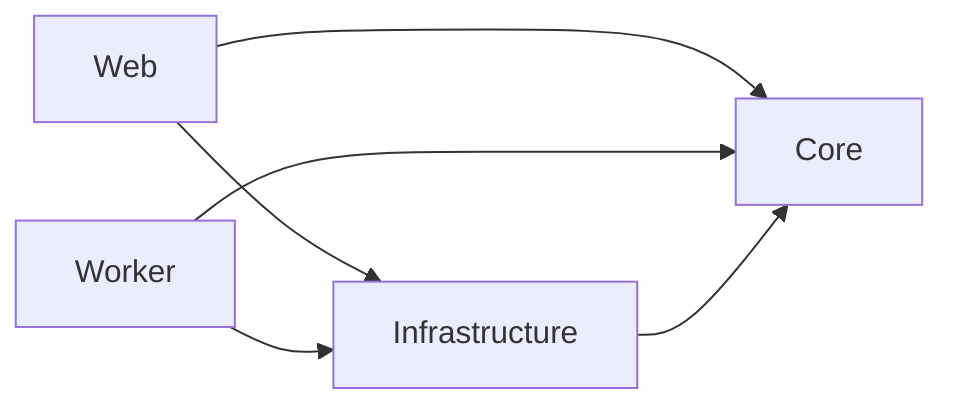

# Source architecture

Source structure includes ADR-0049's Linux App Service Web composition: the
Web host is a framework-dependent, ReadyToRun Linux x64 `web.zip` deployed to
a `DOTNETCORE|10.0` App Service Web App; the Worker is a Flex Consumption
Function App. `infra/modules/platform.bicep` supplies the Web plan, App
Service configuration and managed identity; the release route deploys the
package with `az webapp deploy`. Both hosts configure SQL Server through
`Pegasus.Infrastructure.Persistence.PegasusSqlServer.Configure`, whose
execution strategy retries transient faults outside a store transaction and
runs once inside one. A store opens its transaction through
`PegasusTransactions`: read committed, or serializable where the store names
the override ([ADR-0074](adr/0074-read-committed-default-transaction-isolation.md)).
Refresh this document when source structure changes. [Operations](operations.md)
owns dated deployed observations and exact runtime identities.

## Components and dependency direction

Core owns policy and ports. Infrastructure implements Core ports. Web and Worker
are composition roots depending on both. No additional application project,
workflow engine or imported source becomes a second business-policy owner.

The mail classifier agent (`src/pegasus-classifier-agent`, TypeScript on its
own Flex Consumption Function App from `infra/modules/classifier.bicep`) is an
Automation MCP client, not a composition root. It reaches Pegasus only through
`/mcp/mail` under `automation.mail`, so Pegasus applies the same checks to its
writes as to any Automation caller. Its three tools list, classify and link
mail that is Unclassified or has no Case, and leave any message staff or an
Automation caller has decided.

## Flows and data ownership

- Contacts uses Organization identities, each with one type
  (`Organizations.Role`), and Principal links. Principal policy remains on
  Principal records; Contacts owns the administration routes. Staff accounts
  have exactly one role.
- Triage Cases and Image Intake records use typed, versioned edit scopes; a
  Triage Case's scope is also its authority for Case custody and upload
  association. Administration settings use expected-version checks on each
  save. Case editing keeps its workflow lease and one atomic workspace save.
- Direct manual Case creation shares the permanent reference allocator with
  receipt acceptance and Triage creation, and creates no intake receipt or
  invented source provenance.
- A Case's working values belong to a work of the Case (ADR-0056). Every new
  Case gets its primary work, whose Id is the Case Id; Create audit adds the
  one Audit work. Writes resolve the current work inside their transaction;
  reads name the current or the primary work.
- Notes and immutable applied guidance share the Case workflow timeline.
  Configured completeness and chase intervals are read by the owning
  transactions.
- The Case export is a plain staff download on every standard Case. It writes
  one replay-safe history record and changes no Case state.
- Receipt persists original bytes, source identity and durable work before
  publication. Worker owns queued processing and recovery; notification and
  recovery scheduling use the accepted unified queue boundary.
- Staff uploads and retained intake use bounded streams for validation,
  hashing and retention. Custody verifies a temporary file before writing
  managed content; local storage and Box accept streamed writes with explicit
  length and hash. A Box write proves its folder and checks each upload's
  parent from Box's own answer, never from the read path's memory. After Box
  confirms a file and its record is saved, the filer writes its read-cache
  copy through `IDocumentContentCachePublisher`, which never throws.
- Core route/classification/matching policy determines formal Case, Triage,
  image-origin and Unidentified outcomes. Their identities remain distinct.
- SQL owns application state and provenance. Box owns durable file custody;
  Azure provides processing storage and a derived idle cache.
- Staff, Principal API and Automation callers share Core authorization, state,
  version and policy gates. Automation's attributed writes do not confer
  professional approval or outward-send permission.
- Native engineering and retained report generation use the integrated
  renderer in the existing Web/Infrastructure boundary.
- Mail sending tracks attempted operations separately from observed Sent
  evidence.
- The AiJobs pull ledger is the one AI integration boundary.

## Implementation map

| Responsibility | Current source |
| --- | --- |
| Core intake receipt/query/command use cases | `src/Pegasus.Core/Intake/` |
| Core source-download contract and policy | `src/Pegasus.Core/Intake/DownloadIntakeSource.cs`, `src/Pegasus.Core/Intake/IntakeContracts.cs` |
| QDOS extraction policy | `src/Pegasus.Core/Intake/DirectPrincipals/Qdos/QdosInstructionExtractionPolicy.cs` |
| Evidenced principal mail route, classification, and case-match policies | `src/Pegasus.Core/Intake/PrincipalMailRoutePolicy.cs`, `src/Pegasus.Core/Intake/Classification/PrincipalMailClassificationPolicy.cs`, `src/Pegasus.Core/Intake/CaseMatching/PrincipalCaseMatchPolicy.cs`; intermediaries from the Contacts directory: `src/Pegasus.Core/Intake/IntermediaryDomains.cs` (`IIntermediaryRegistry`), `src/Pegasus.Infrastructure/Persistence/EfIntermediaryRegistry.cs` ([ADR-0078](adr/0078-intermediaries-are-linked-claim-sources.md)) |
| Core mail categories (three: New instruction, Triage request, Cancellation; [ADR-0085](adr/0085-mail-is-instructions-or-correspondence-and-queries-are-assignable.md)) | `src/Pegasus.Core/Intake/Classification/MailClassificationContracts.cs` (`MailCategory`, `MailCategories`, `MailClassificationResult.OpensQuery`) |
| Query criteria on a joined message | `CaseQueryRules.OpensOnMailJoined`; `EfIntakeMutationStore` opens through `CaseQueryLedger.OpenForMessageAsync` when `OpensQuery` is set; a category correction neither opens nor withdraws a query |
| Core case-match evaluator and `CaseMatchIndex` read model | `src/Pegasus.Core/Intake/CaseMatching/` (with `AutomaticMailCaseAssociation.cs` and `MailClaimReferenceTokens.cs`), `src/Pegasus.Infrastructure/Persistence/CaseMatchEntities.cs` |
| Core image-intake registration, pairing, and lifecycle use cases | `src/Pegasus.Core/ImageIntake/` |
| In-process ONNX VRM recognition engine (ADR-0019) | `src/Pegasus.Infrastructure/Vision/` |
| Multi-format source adapter | `src/Pegasus.Infrastructure/Intake/MimeKitPdfPigOpenXmlIntakeSourceReader.cs`; beside it `ScanPageClassifier.cs` tells a scanned page from a full-page photograph ([ADR-0061](adr/0061-ocr-every-scanned-document-page.md)) and `PdfPageRasteriser.cs` renders a refused full-page raster with PDFium ([ADR-0081](adr/0081-render-a-refused-full-page-raster-with-pdfium.md)) |
| Incoming scanned-document OCR | OCR of each scanned document on every non-Automation source, then third-party report reading and, while a Principal is needed, instruction analysis: `src/Pegasus.Core/Intake/IntakeOcr.cs`, `IntakeOcrText.cs`, `ProcessIntakeOcr`, `ThirdPartyReports/RecordThirdPartyReportReading.cs`, `AnalyzeRetainedInstruction.cs`; Azure Document Intelligence in Infrastructure; durable processing in Worker ([ADR-0061](adr/0061-ocr-every-scanned-document-page.md)) |
| Estimate import | `src/Pegasus.Core/Assessment/EstimateImport.cs` over deterministic Infrastructure parsers; estimates do not enter OCR |
| Glass's Repair Estimate launch, return and import | Session contract `src/Pegasus.Core/Assessment/GlassRepairEstimates.cs`; gateway and client `src/Pegasus.Infrastructure/Glass/` (placeholder vehicle, ADR-0062); a repair spec's estimate `CaseRepairSpecifications.Glass*`; provider return `Pages/Integrations/Glass/Callback.cshtml.cs`; provider work in `src/Pegasus.Web/Background/` (`ProviderWorkQueue`, `ProviderWorkService`) composed by `Pages/Integrations/Glass/GlassSessionWork.cs` (ADR-0058); owner-only window `Pages/Integrations/Glass/Opening.cshtml`, return `_GlassReturn.cshtml`, cross-site bounce `Pages/Shared/_GlassBounce.cshtml`; the four `Glass:*` settings are Production required keys in `src/Pegasus.Web/Program.cs`, supplied by Bicep to the Web App only |
| Guide valuation, Glass's, Cazana and Brego valuation | `src/Pegasus.Core/Assessment/GuideValuationProviders.cs` (`FetchGuideValuation`, the provider port, `FileGuideValuationReport`, which takes no Case version or edit lease); providers `src/Pegasus.Infrastructure/Glass/GlassGuideValuationProvider.cs`, `src/Pegasus.Infrastructure/Cazana/CazanaGuideValuationProvider.cs` ([ADR-0079](adr/0079-cazana-companion-account-and-companion-report.md)) and `src/Pegasus.Infrastructure/Brego/BregoGuideValuationProvider.cs` ([ADR-0084](adr/0084-brego-valuation-account-and-valuation-report.md)), composed in `src/Pegasus.Web/Program.cs`'s Production block beside their required keys; report filing `src/Pegasus.Web/Background/GuideValuationReportScheduler.cs` (ADR-0060) |
| Local artifact adapter | `src/Pegasus.Infrastructure/Intake/FileSystemIntakeArtifactStore.cs` |
| EF receipt, current-association and action-history persistence | `src/Pegasus.Infrastructure/Persistence/EfIntakeReceiptStore.cs`, `src/Pegasus.Infrastructure/Persistence/EfIntakeMutationStore.cs`, `src/Pegasus.Infrastructure/Persistence/EfCaseAcceptanceStore.cs` |
| EF image-intake persistence | `src/Pegasus.Infrastructure/Persistence/EfImageIntakeStore.cs` |
| Database model and migrations | `src/Pegasus.Infrastructure/Persistence/PegasusDbContext.cs`; `src/Pegasus.Infrastructure/Persistence/Migrations/` (one `Baseline` migration with the runtime roles, the grants and denials of `RuntimePermissions.csv` and the seed rows); compiled model `src/Pegasus.Infrastructure/Persistence/CompiledModel/`, regenerated with every migration (the `unit` CI lane fails when it is stale) |
| Web composition, feature gates and route safety | `src/Pegasus.Web/Program.cs` |
| Worker functions and their schedules | `src/Pegasus.Worker/IntakeFunctions.cs`, `EmailEvidenceFunctions.cs` (queue, poison and timer functions; `PendingWorkRecoveryFunction` also runs `RunDueChasers`, the approved-inbox recovery, the pending-wake poll and the sent-report instruction tidy `src/Pegasus.Core/Workflow/SentReportInstructionTidy.cs`, ADR-0071); schedules and `Disabled` settings `infra/modules/platform.bicep`; log filters `src/Pegasus.Worker/host.json`; kept in step by `tests/Pegasus.ArchitectureTests/WorkerTimerContractTests.cs` |
| Staff cookie check, page and JSON compression and startup readiness | Account check `src/Pegasus.Web/Authentication/StaffPrincipalValidator.cs` over `src/Pegasus.Infrastructure/Persistence/StaffAccountReads.cs`; evictable caches through `EvictableCacheEntry.cs`; stamp rotation kept with its owners by `tests/Pegasus.ArchitectureTests/StaffAuthorityStampRotationTests.cs`; compression in `Program.cs` (ADR-0057, ADR-0077); warm-up and readiness `src/Pegasus.Web/Health/StartupWarmup.cs`, `DatabaseReadinessHealthCheck`, `src/Pegasus.Web/Mcp/OAuthCertificateStore.cs`, `StartupTimeline.cs` ([runbook § Web start](runbook.md)): none of it writes and no remote read holds the port; `/health` is not redirected to HTTPS |
| Designed case refusals kept out of the exception index | `src/Pegasus.Web/Pages/Cases/DesignedCaseRefusal.cs` is the one classifier; `CaseMutationPageModel.cs` logs a refusal with type and message only; refusal types in `src/Pegasus.Core/Workflow/CaseWorkflowContracts.cs` |
| Client aborts kept out of the exception index | `src/Pegasus.Web/ClientAbort.cs` is the one classifier; `ClientAbortExceptionHandler.cs` ends an aborted request as a 499; `QuietRequestTelemetryFilter.cs` drops its exception row |
| Concurrent page reads | `src/Pegasus.Web/Presentation/BoundedReads.cs` runs a request's independent reads, at most four at a time, for readers on their own context-factory context (the Case page phases in `Pages/Cases/Details.cshtml.cs`); `Pages/Index.cshtml.cs`, `Pages/Mail/Index.cshtml.cs` and `Presentation/ShellPageFilter.cs` (not on a page marked `Presentation/IShellFreeGet.cs`) start their reads together without it |
| Core retained-mail read model, use cases and freshness policy | `src/Pegasus.Core/Intake/RetainedMail.cs` |
| EF retained-mail store (poll write path and workspace read path) | `src/Pegasus.Infrastructure/Persistence/EfRetainedMailboxMessageStore.cs`; reply headers from `src/Pegasus.Infrastructure/Intake/LocalEmailDisplayReader.cs` |
| Inbox Dismiss and Restore store and its Web grant | `src/Pegasus.Infrastructure/Persistence/EfRetainedMailDismissalStore.cs`; the Web role's UPDATE on `RetainedMailboxMessages` is a row of `RuntimePermissions.csv` |
| Retained-file viewer callers, and Send Unidentified to AI | `src/Pegasus.Web/Pages/Intake/Source.cshtml.cs`; `src/Pegasus.Web/Pages/Unidentified/Details.cshtml.cs`; a Draft ready job's review link is `StaffNotificationPolicy.AiDraftRoute` |
| Manual upload staging and staged-receipt status callers | `src/Pegasus.Web/Pages/Upload.cshtml.cs`, `src/Pegasus.Web/Pages/UploadStatus.cshtml.cs`, `src/Pegasus.Infrastructure/Persistence/EfQueuedIntakeStatusQueries.cs` |
| Canonical mail-workspace callers (`/Inbox`) | `src/Pegasus.Web/Pages/Mail/Index.cshtml.cs` (no preview read), `src/Pegasus.Web/Pages/Mail/Message.cshtml.cs` (`GetRetainedMail`, the dialog `src/Pegasus.Web/Pages/Mail/Shared/_MessageDialog.cshtml`); `GetRetainedMailPreview` serves the Unidentified record |
| Triage Case page and Triage persistence | Core `src/Pegasus.Core/Triage/`; `src/Pegasus.Infrastructure/Persistence/EfTriageStore.cs` (Case and Triage record together, the Principal gate); Web `src/Pegasus.Web/Pages/Cases/Details.Triage.cs`, `Pages/Cases/Shared/_TriageCase.cshtml`; `TriageCaseRouteFilter` answers Not found for a Triage id on the other Case capability pages; there is no `Pages/Triage/` route |
| Case workspace and its capability pages | `src/Pegasus.Web/Pages/Cases/Details.cshtml.cs` (the one scrolling Case record, its Inspection and Audit views, edit lease and saves); handler pages `Workflow`, `Tasks`, `Custody`, `Vehicle`, `Closure` on `src/Pegasus.Web/Pages/Cases/CaseMutationPageModel.cs` (edit mode, `HeartbeatLease`); partials `src/Pegasus.Web/Pages/Cases/Shared/`; save-as-you-go commits `Pages/Cases/Details.CommitResult.cs`, other mutations redirect to the workspace; client `wwwroot/js/case-workspace.js` |
| Genuine-input Web evidence | `tests/Pegasus.IntegrationTests/QdosIntakeWebTests.cs` |
| Route-denial evidence | `tests/Pegasus.IntegrationTests/LocalIntakeAccessTests.cs` |
| Stable persistence and unsupported-source evidence | `tests/Pegasus.IntegrationTests/IntakeStablePersistenceTests.cs` |
| Retained-mail persistence and mail-workspace Web evidence | `tests/Pegasus.IntegrationTests/RetainedMailPersistenceTests.cs`, `tests/Pegasus.IntegrationTests/MailWorkspaceWebTests.cs` |
| LocalDB migration, concurrency, rollback, and retry evidence | `tests/Pegasus.IntegrationTests/IntakePersistenceIntegrationTests.cs` |
| Dependency-direction evidence | `tests/Pegasus.ArchitectureTests/DependencyDirectionTests.cs` |
| Report-requirement ownership evidence | `tests/Pegasus.ArchitectureTests/ReportRequirementOwnershipTests.cs` |
| Core assessment-report and Estimate document contracts and callers | `src/Pegasus.Core/Reports/AssessmentReportRendering.cs`, `src/Pegasus.Core/Reports/EstimateDocumentRendering.cs` |
| Integrated QuestPDF report adapters, shared governed chrome and embedded fonts (ADR-0050) | `src/Pegasus.Infrastructure/Reports/ReportChrome.cs`, `PageCountProbe.cs`, `EstimateDocumentLayout.cs`, `QuestPdfEstimateDocumentRenderer.cs`, the assessment renderer, `ReportPhotoPreparation.cs` and `ReportRenderGate.cs` (render admission; images open one at a time through `ReportImageContent` after one batched `IReadLogicalDocumentVersion.PrepareAsync`), composed by `src/Pegasus.Infrastructure/DependencyInjection.cs` |
| The printed report's wording | `src/Pegasus.Core/Reports/AssessmentReportWording.cs` (all printed text outside the narrative), `src/Pegasus.Core/Reports/ReportWording.cs` (`ReportWordingComposition`, the narrative); the layout under `src/Pegasus.Infrastructure/Reports/` prints from both |
| Vehicle plan geometry | `src/Pegasus.Core/Assessment/DamagePlanGeometry.cs` (drawings from `Assessment/VehiclePlans/`) over `DamageAreaGeometry.cs`; drawn by `src/Pegasus.Web/Pages/Cases/Shared/_CaseDamage.cshtml` and `src/Pegasus.Infrastructure/Reports/DamagePlanDrawing.cs` |
| Report template conformance evidence | `tests/Pegasus.IntegrationTests/Reports/AssessmentReportTemplateConformanceTests.cs` (the `reference/rendererref1` sample jobs, `TemplateSampleJobs.cs`, `PrintedPages.cs`); `tests/Pegasus.ArchitectureTests/ReportLayoutWordingTests.cs` proves the layout holds no printed text of its own |
| Report generation, and settling a report whose file is filed later | `src/Pegasus.Core/Reports/CaseReportGeneration.cs` (`GenerateCaseReport`, `ISettleFiledCaseReportArtifacts`); `src/Pegasus.Infrastructure/Persistence/EfCaseReportGenerationStore.cs`, `EfSettleFiledCaseReportArtifacts.cs`; custody `src/Pegasus.Infrastructure/Custody/EfCaseArtifactCustody.cs`; settled by the Worker's `StagedArtifactReconciliationFunction`; the Worker role's update grant is a row of `RuntimePermissions.csv` |
| Case image tags (vocabulary, per-occurrence assignments, Case export exclusion by the Third party tag) | `src/Pegasus.Core/Documents/ImageTags.cs`; `src/Pegasus.Infrastructure/Persistence/EfDocumentCustodyStore.cs`; exclusion `CaseExportPolicy.SelectEligibleImages` |
| Case document types changed after filing | `src/Pegasus.Core/Documents/SetDocumentType.cs` (`DocumentTypePolicy`); `src/Pegasus.Infrastructure/Persistence/EfDocumentCustodyStore.cs` (the Mark path); caller `src/Pegasus.Web/Mcp/DocumentActionMcpTools.cs` (`set_type`) |
| Case export | `src/Pegasus.Core/CaseExport/` (`IExportCaseBundle`); `src/Pegasus.Infrastructure/Persistence/EfCaseExportStore.cs` (the `case_exported` history); Web `src/Pegasus.Web/Pages/Cases/Documents/Export.cshtml.cs` |
| Case document preview and thumbnail reads (no audit row; cached; `size=thumb` variant) | `src/Pegasus.Core/Documents/CaseDocumentPreview.cs`; `src/Pegasus.Infrastructure/Custody/CachedDocumentContentStore.cs`; `src/Pegasus.Web/Pages/Cases/Documents/Download.cshtml.cs`; addresses `src/Pegasus.Web/Presentation/CaseFileAddresses.cs`; matching `prep` and `renderer` identities permit private caching or 304, missing or stale ones get current content with `private, no-store` |
| Automation MCP servers, one per scope (ADR-0080) | Server table `src/Pegasus.Web/Mcp/AutomationMcp.cs`; the one tool-to-scope table `src/Pegasus.Web/Mcp/AutomationToolScopes.cs`; registration `src/Pegasus.Web/Mcp/AutomationMcpExtensions.cs`; clients `src/Pegasus.Web/Mcp/AutomationClientRegistry.cs` |
| Automation document downloads (`pegasus_document_download`, `pegasus_document_download_batch`) | `src/Pegasus.Web/Mcp/AutomationFileContent.cs`, composed by `src/Pegasus.Web/Mcp/DocumentMcpTools.cs`; batch `src/Pegasus.Core/Documents/CaseDocumentBatch.cs` (`IOpenCaseDocumentBatch`) in `src/Pegasus.Infrastructure/Persistence/EfDocumentCustodyStore.cs`; rendering `src/Pegasus.Infrastructure/Custody/ImageDeliveryRenderer.cs`, `src/Pegasus.Infrastructure/Intake/PdfPigPageTextExtractor.cs` |
| Automation documents staged in parts (`pegasus_upload_begin`, `pegasus_upload_part`, [ADR-0083](adr/0083-stage-large-automation-documents-in-parts.md)) | `src/Pegasus.Core/Documents/DocumentUploads.cs` (`IDocumentUploadStaging`, `SweepAbandonedDocumentUploads`); `src/Pegasus.Infrastructure/Custody/DocumentUploadStaging.cs`; `src/Pegasus.Web/Mcp/DocumentUploadMcpTools.cs`; the Worker's sweep in `StagedArtifactReconciliationFunction` (`DocumentUploadSweepSchedule`) |
| Case queries (Report sent and queries) | `src/Pegasus.Core/Lifecycle/CaseQueryLifecycle.cs` (`CaseQueryRules`); `src/Pegasus.Infrastructure/Persistence/CaseQueryLedger.cs` is the only writer of `CaseQueries` and `CaseWorkflows.HasOpenQuery`, inside the owning transactions (`EfStaffMailSendStore` marks done only the replied message's open query) |
| Focused Case rendering reads | `src/Pegasus.Core/Cases/CaseQueries.cs` (page-frame, Vehicle, Valuation, Files and Notes readers); `src/Pegasus.Infrastructure/Persistence/EfCaseQueryStore.cs`; narrower readers `IGetCaseHeader`, `IGetCaseEditBasis`, `IGetCaseSectionFrame`, `ICaseWorkflowQueries`, `ICaseDocumentQueries`, `IAvailableReportSentEvidenceQueries`; no reader loads every body of a Case at once; Files' lease validator never acquires or renews a lease |
| Request and document-read phase timing | `src/Pegasus.Core/Documents/DocumentReadTelemetry.cs`; `src/Pegasus.Web/DocumentReadTelemetryBridge.cs` (sampled Application Insights); `WorkspaceRequestTimingFilter`; runtime diagnostics ([runbook § Runtime diagnostics](runbook.md)) `src/Pegasus.Infrastructure/Persistence/ConnectionOpenTimingInterceptor.cs`, `DeadlockLoggingInterceptor.cs`, `src/Pegasus.Web/Health/RequestRuntimeStamps.cs`, `RuntimeHeartbeat.cs`, `RuntimeCounters.cs`; no browser SDK or ingestion endpoint; offline hosting composes neither the bridge nor the production Blob document cache |
| Record edit scopes for Image Intake records (same-holder re-claim, colleague Take over, beacon release) and Triage Cases (held for one save) | `src/Pegasus.Core/Workflow/RecordEditScope.cs`, `src/Pegasus.Infrastructure/Persistence/EfEditScopeStore.cs`, `src/Pegasus.Web/wwwroot/js/edit-scope-release.js`; `src/Pegasus.Web/Presentation/TriageWriteAuthority.cs`; `src/Pegasus.Infrastructure/Persistence/CaseMutationAuthority.cs` (custody and upload authority) |
| Automatic vehicle lookup at Case creation and the reconciliation sweep | `src/Pegasus.Infrastructure/Persistence/EfVehicleWorkflowStore.cs` (`EnqueueForCase`); provider `src/Pegasus.Infrastructure/Vehicle/DvlaDvsaProductionAdapter.cs`; fill policy `src/Pegasus.Core/Vehicle/VehicleLookupFillPolicy.cs`, applied by `src/Pegasus.Infrastructure/Persistence/EfVehicleLookupWorkStore.cs` |
| An Audit's Original report cells filled from its filed report | `src/Pegasus.Core/Assessment/OriginalReportPrefill.cs`, `ReadOriginalReport.cs`; `src/Pegasus.Infrastructure/Persistence/OriginalReportPrefillWriter.cs` fills only cells staff have not recorded, in the acceptance (`EfCaseAcceptanceStore.cs`), Mark and recognition (`EfDocumentCustodyStore.cs`) transactions; the Worker's `DocumentOccurrences` UPDATE is a row of `RuntimePermissions.csv` |
| A capture document's vehicle identity and photographs (Tractable, FRD-02 `EXT-17`) | `src/Pegasus.Core/Intake/ThirdPartyReports/ThirdPartyReportProfiles.cs` (`tractable-capture/1`, a `VehicleCapture` role that never holds back image automation), `ThirdPartyReportExtraction.cs`, `VehicleCapture.cs`, `VehicleCaptureFill.cs`; pairing on the printed registration `src/Pegasus.Core/ImageIntake/ImageIntakeAutomation.cs`; writer `src/Pegasus.Infrastructure/Persistence/VehicleCaptureFillWriter.cs` |
| A Principal's salvage matrix, which fills the Case salvage value | `src/Pegasus.Core/Assessment/SalvageMatrix.cs`; command in `src/Pegasus.Core/Cases/OrganizationAdministration.cs`; `src/Pegasus.Infrastructure/Persistence/EfPrincipalSalvageMatrixQueries.cs`, `EfOrganizationAdministration.cs` (`Principals.SalvageMatrixJson`) |
| A Principal's default fee, which a new Case takes as its agreed fee | `src/Pegasus.Core/Cases/PrincipalDefaultFeePolicy.cs`; command in `src/Pegasus.Core/Cases/OrganizationAdministration.cs`; `src/Pegasus.Infrastructure/Persistence/PrincipalDefaultFeeWriter.cs` (`Principals.DefaultFee`) |
| A Principal's reviewed inspection locations, offered at Inspect at | `src/Pegasus.Core/Address/InspectionLocations.cs` (`IInspectionLocationAdministration`, the one writer; `InspectionLocationPolicy`); `src/Pegasus.Infrastructure/Persistence/EfInspectionLocationAdministration.cs`, `InspectionAddressChoicesQueries.cs` |
| The management event after each report send (`MAIL-17`) | `src/Pegasus.Core/Reports/ManagementEvents.cs`; written inside the Sent observation's transaction by `src/Pegasus.Infrastructure/Persistence/EfStaffMailSendStore.cs` (`RecordManagementEventAsync`) |
| Administration › Logs: Action logs (acting-principal security events, AI-job record links) and the Intake log (one row per received file, its outcome, and Re-evaluate, Retry allocation and Retry OCR) | `src/Pegasus.Infrastructure/Persistence/EfActionLogQueries.cs`; `src/Pegasus.Core/Operations/IntakeLogQueries.cs` (`IListIntakeLog`), `src/Pegasus.Infrastructure/Persistence/EfIntakeLogQueries.cs`, `src/Pegasus.Core/Intake/RetryIntakeOcr.cs`; Web `src/Pegasus.Web/Pages/Administration/Logs.cshtml.cs`, `src/Pegasus.Web/Presentation/AiJobActions.cs` |
| Management Reports (MI-01 to MI-06, the workbook, the Case list and its presets) | `src/Pegasus.Core/Reports/EngineerActivityReport.cs`, `V1ActivityReport.cs`, `AdministrationReportWorkbook.cs`, `ReportOutcomes.cs`, `ReportPeriods.cs`, `CaseListColumns.cs`, `CaseListReport.cs`, `CaseListPresets.cs`; `src/Pegasus.Infrastructure/Persistence/EfEngineerActivityQueries.cs`, `EfV1ActivityReportQueries.cs`, `EfMonthlyReportActivityQueries.cs`, `EfReportOutcomeQueries.cs`, `EfCaseListQueries.cs`, `EfCaseListPresetStore.cs`; `src/Pegasus.Infrastructure/Reports/OpenXmlWorkbookWriter.cs` |
| Personal notifications (the bell) | `src/Pegasus.Core/Notifications/`; `src/Pegasus.Infrastructure/Persistence/EfStaffNotificationStore.cs`; Web `src/Pegasus.Web/Pages/Notifications.cshtml.cs` (also the shell dialogs' `ShellDialog` handler), `Pages/Shared/_ShellDialogs.cshtml`, `_NotificationList.cshtml`; the Worker's purge sweep in `src/Pegasus.Worker/IntakeFunctions.cs` |
| Release notes (What's new) | `src/Pegasus.Core/ReleaseNotes/ReleaseNotes.cs`; `src/Pegasus.Infrastructure/Persistence/EfReleaseNoteStore.cs`; Web `Pages/Administration/ReleaseNotes/`, `Pages/ReleaseNotes.cshtml.cs` |
| Problem reports | `src/Pegasus.Core/Support/ProblemReports.cs`; `src/Pegasus.Infrastructure/Persistence/EfProblemReportStore.cs`; outbound-only sink `src/Pegasus.Infrastructure/Support/GitHubIssueProblemReportSink.cs` |
| E-mail templates (Administration) | `src/Pegasus.Core/Operations/EmailTemplates.cs`; values `src/Pegasus.Core/Triage/TriageOutcomeReply.cs`, `src/Pegasus.Core/Tasks/CaseChaserFacts.cs`, `src/Pegasus.Core/Tasks/CaseChaserRecipients.cs`; `src/Pegasus.Infrastructure/Persistence/EfEmailTemplateStore.cs`, `EfCaseChaserRecipientQueries.cs` |
| Which approved mailbox a send leaves from | `src/Pegasus.Core/Identity/ApprovedMailboxAdministration.cs` (`ApprovedMailboxRouteScope`; `ApprovedMailbox.CanSend`, the one send-ready rule); `src/Pegasus.Core/Operations/CaseMailSender.cs` (`ResolveCaseMailSender`: a report or chaser replies from the instruction email's mailbox, else leaves the chosen Outgoing mailbox), `src/Pegasus.Infrastructure/Persistence/EfCaseInstructionEmailQueries.cs`; the one encoded-message limit `ApprovedStaffSendMailbox.OutgoingEncodedMessageSizeLimit` in `src/Pegasus.Core/Operations/StaffMailSendEngine.cs` |
| Create audit (the Audit of an Inspection + Audit Case) | `src/Pegasus.Core/Lifecycle/CreateAudit.cs` (`AuditPolicy`, `ICreateAudit`); `src/Pegasus.Infrastructure/Persistence/EfCreateAuditStore.cs`; the `a.` Box subfolder in `EfQueuedCustodyProcessor.cs` |
| Case works, references and type codes (ADR-0056) | `src/Pegasus.Core/Cases/CaseWork.cs`, `src/Pegasus.Core/Cases/CaseReferenceFormat.cs` (the one reference formatter and prefix rule); `src/Pegasus.Infrastructure/Persistence/CaseWorkEntities.cs`, `CaseWorkModelConfiguration.cs`, `CaseWorkScope.cs`, `PegasusDbContext.cs`, `CaseTypeCodes.cs`, `CaseIdentityAllocator.cs` and `StoreConcurrencyRetry.cs` (locked, retried allocation), `CaseCustodyFolders.cs` |
| Work Centre and shell preferences | `src/Pegasus.Core/Operations/OperationsSnapshot.cs`, `RecentCases.cs`, `SystemActions.cs` (ADR-0086), `WorkCentreAiJobs.cs`, `WorkCentreDismissals.cs`, `WorkCentreActivity.cs`, `src/Pegasus.Core/AiWork/AiDrafts.cs`; `src/Pegasus.Infrastructure/Persistence/EfWorkCentreDismissalStore.cs`, `EfWorkCentreActivityQueries.cs`, `EfSystemActionQueries.cs`, `EfAiDraftAdoptionQueries.cs`, `EfRecentCaseQueries.cs`; Web `src/Pegasus.Web/Pages/Index.cshtml.cs`, `src/Pegasus.Web/Presentation/ShellPreferences.cs`; there is no working-set strip |
| Background plain thumbnails and the Box read memory | `src/Pegasus.Core/Documents/PrepareDocumentThumbnails.cs`, `src/Pegasus.Infrastructure/Custody/EfDocumentThumbnailCandidates.cs`, run from the Worker's `StagedArtifactReconciliationFunction`; Box read memory and `Retry-After` wait in `BoxContentClient` (`src/Pegasus.Infrastructure/Custody/BoxCaseCustody.cs`) and `BoxDocumentContentStore.ReadGatedWithRetryAsync`; uploads only into a folder proved by `ProveCaseFolderAsync` or `ProveFolderAsync` |
| Filed-estimate recognition | `src/Pegasus.Core/Assessment/RecogniseFiledEstimates.cs`; `EstimateFormats` in `src/Pegasus.Core/Assessment/EstimateImport.cs`, the one rule for what an estimate document is; `src/Pegasus.Infrastructure/Custody/EfEstimateRecognitionCandidates.cs` (`DocumentVersions.IsRecognisedEstimate`), run from the Worker's `StagedArtifactReconciliationFunction`; Import as repair spec only on a recorded estimate (`IsImportableEstimate`) |
| Pre-Case image crop and tag, and their prepared tiles | `src/Pegasus.Core/ImageIntake/PreCaseImagePreparation.cs`, `src/Pegasus.Core/ImageIntake/PreCaseImageThumbnail.cs`; `src/Pegasus.Infrastructure/Persistence/EfPreCaseImagePreparationStore.cs`; rendering `ImageThumbnailRenderer` in `src/Pegasus.Infrastructure/Custody/CachedDocumentContentStore.cs` |
| Per-attachment outcomes of a retained message | `src/Pegasus.Core/Intake/RetainedMailAttachmentOutcomes.cs`; Web `src/Pegasus.Web/Pages/Mail/Message.cshtml.cs` |

## Technical decisions

Read the [ADR index](adr/README.md) and each record's surviving clauses and
successors. Hosting, queued intake, mailbox identity, automation
authorization, renderer packaging and custody each retain their technical
owner. Partial supersession is not whole-record replacement.

## Reference inputs

Principal generators consume supplied evidence and emit review/reference
data; these artifacts do not activate routes. Admitted runtime policy lives
in Core. The one-off reference-data loader, `scripts/reference-data-loader/`,
composes Core and Infrastructure, hosts nothing and owns no policy.
[Reference authoring](runbook.md) owns generator commands; supplied vendor
specifications live in
[external component documents](external-component-documents/README.md).

## Configuration and deployment

[Configuration](engineering/configuration.md) defines settings. The release
skill owns packaging/deployment; one workstation platform produces the
authorized artifacts. A source composition flag or built adapter alone does
not establish the deployed configuration or acceptance. Retired source
imports are described by the [workspace boundary](../workspaces/README.md).
