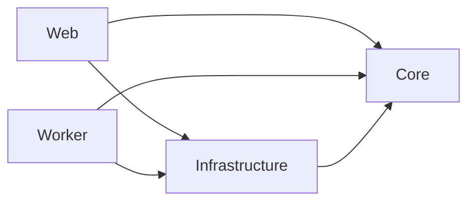

# Source architecture

Source structure includes ADR-0049's Linux App Service Web composition: the
Web host is a framework-dependent, ReadyToRun Linux x64 `web.zip` deployed to
a `DOTNETCORE|10.0` App Service Web App; the Worker is a Flex Consumption
Function App. `infra/modules/platform.bicep` supplies the Web plan, App
Service configuration and managed identity; the release route deploys the
package with `az webapp deploy`. Both hosts configure SQL Server through
`Pegasus.Infrastructure.Persistence.PegasusSqlServer.Configure`, whose
execution strategy retries transient faults outside a store transaction and
runs once inside one. A store opens its transaction through
`PegasusTransactions`: read committed, or serializable where the store names
the override ([ADR-0074](adr/0074-read-committed-default-transaction-isolation.md)).
Refresh this document when source structure changes. [Operations](operations.md)
owns dated deployed observations and exact runtime identities.

## Components and dependency direction

Core owns policy and ports. Infrastructure implements Core ports. Web and Worker
are composition roots depending on both. No additional application project,
workflow engine or imported source becomes a second business-policy owner.

The mail classifier agent (`src/pegasus-classifier-agent`, TypeScript on its
own Flex Consumption Function App from `infra/modules/classifier.bicep`) is an
Automation MCP client, not a composition root. It reaches Pegasus only through
`/mcp` under `automation.mail` and calls the mail tools as any Automation
caller does, so Pegasus applies the same checks to its writes. Its six tools
list, classify and link mail that is Unclassified or has no Case, open a
query, and look up the old system's Box folders and the approved mailboxes
through Pegasus's two read-only lookup tools (R550); they leave any message
staff or an Automation caller has decided.

## Flows and data ownership

- Contacts uses Organization identities, each with one type
  (`Organizations.Role`), and Principal links. Principal policy remains on
  Principal records; Contacts owns the administration routes. Staff accounts
  have exactly one role.
- Triage Cases and Image Intake records use typed, versioned edit scopes; a
  Triage Case's scope is also its authority for Case custody and upload
  association. Administration settings use expected-version checks on each
  save. Case editing keeps its workflow lease and one atomic workspace save
  for data, assessment, damage, image preparation, the Draft repair
  specification, guide cards and valuation adoption.
- Direct manual Case creation shares the permanent reference allocator with
  receipt acceptance and Triage creation. It creates no intake receipt or
  invented source provenance.
- A Case's working values belong to a work of the Case (ADR-0056). The
  persistence context gives every new Case its primary work, whose Id is the
  Case Id; Create audit adds the one Audit work. Writes resolve the current
  work inside their transaction; reads name the current or the primary work.
- Notes and immutable applied guidance share the Case workflow timeline.
  Configured completeness and chase intervals are read by the owning
  transactions.
- The Case export is a plain staff download on every standard Case. It writes
  one replay-safe history record and changes no Case state.
- Receipt persists original bytes, source identity and durable work before
  publication. Worker owns queued processing and recovery; notification and
  recovery scheduling use the accepted unified queue boundary.
- Staff uploads and retained intake use bounded streams for validation,
  hashing and retention. Custody verifies a temporary file before writing
  managed content; local storage and Box accept streamed writes with explicit
  length and hash. Existing in-memory callers retain their own entry points
  into the same policy. A Box write reads its folder once to prove it and
  checks each upload's parent from Box's own answer; it never uses the read
  path's memory. A custody work item's files upload up to three at a time
  (`EfQueuedCustodyProcessor.RetainTogetherAsync`), keeping the files' order.
  Once Box has confirmed a file and its record is saved, the filer writes the
  file's read-cache copy through `IDocumentContentCachePublisher`, which
  `CachedDocumentContentStore` implements and `EfCaseArtifactCustody`,
  `ReconcilePendingArtifactCustody`, `EfDocumentCustodyStore` and
  `EfQueuedCustodyProcessor` call. It never throws and gives up on a write
  after five seconds; once one write has failed it skips the rest of its
  scope's: a Web request, a queued work item, or a whole run of the Worker's
  reconciliation timer.
- Core route/classification/matching policy determines formal Case, Triage,
  image-origin and Unidentified outcomes. Their identities remain distinct.
- SQL owns application state and provenance. Box owns durable file custody;
  Azure provides processing storage and a derived idle cache.
- Staff, Principal API and Automation callers share Core authorization, state,
  version and policy gates. Automation's attributed writes do not confer
  professional approval or outward-send permission.
- Native engineering and retained report generation use the integrated
  renderer in the existing Web/Infrastructure boundary.
- Mail sending tracks attempted operations separately from observed Sent
  evidence.
- The AiJobs pull ledger is the one AI integration boundary.

## Implementation map

| Responsibility | Current source |
| --- | --- |
| Core intake receipt/query/command use cases | `src/Pegasus.Core/Intake/` |
| Core source-download contract and policy | `src/Pegasus.Core/Intake/DownloadIntakeSource.cs`, `src/Pegasus.Core/Intake/IntakeContracts.cs`; the upload review's image from intake bytes, `src/Pegasus.Core/Intake/ReadUploadedImage.cs` |
| QDOS extraction policy | `src/Pegasus.Core/Intake/DirectPrincipals/Qdos/QdosInstructionExtractionPolicy.cs` |
| Evidenced principal mail route, classification, and case-match policies | `src/Pegasus.Core/Intake/PrincipalMailRoutePolicy.cs`, `src/Pegasus.Core/Intake/Classification/PrincipalMailClassificationPolicy.cs`, `src/Pegasus.Core/Intake/CaseMatching/PrincipalCaseMatchPolicy.cs`; the intermediaries the route reads from the Contacts directory: `src/Pegasus.Core/Intake/IntermediaryDomains.cs` (`IIntermediaryRegistry`, `IntermediaryDomains`), `src/Pegasus.Infrastructure/Persistence/EfIntermediaryRegistry.cs` ([ADR-0078](adr/0078-intermediaries-are-linked-claim-sources.md)) |
| Core mail categories (four: New instruction, Triage request, Cancellation, Pre-Pegasus case; [ADR-0085](adr/0085-mail-is-instructions-or-correspondence-and-queries-are-assignable.md)) | `src/Pegasus.Core/Intake/Classification/MailClassificationContracts.cs` (`MailCategory`, `MailCategories`, `MailClassificationResult.OpensQuery`) |
| Query criteria on a joined message | `CaseQueryRules.OpensOnMailJoined`; `EfIntakeMutationStore` opens through `CaseQueryLedger.OpenForMessageAsync` when the decision's `OpensQuery` is set; a category correction does not open or withdraw a query |
| Core case-match evaluator and `CaseMatchIndex` read model | `src/Pegasus.Core/Intake/CaseMatching/` (the shared evaluator and `principal_case_match` policy, the `mail_case_association` v2 policy in `AutomaticMailCaseAssociation.cs`, its bounded claim-reference tokens in `MailClaimReferenceTokens.cs`), `src/Pegasus.Infrastructure/Persistence/CaseMatchEntities.cs` |
| Core image-intake registration, pairing, and lifecycle use cases | `src/Pegasus.Core/ImageIntake/` |
| In-process ONNX VRM recognition engine (ADR-0019) | `src/Pegasus.Infrastructure/Vision/` |
| Multi-format source adapter | `src/Pegasus.Infrastructure/Intake/MimeKitPdfPigOpenXmlIntakeSourceReader.cs`; beside it `ScanPageClassifier.cs` tells a scanned document page (no image, OCR) from a photograph that fills the page (an ordinary image) ([ADR-0061](adr/0061-ocr-every-scanned-document-page.md)), and `PdfPageRasteriser.cs` renders the page around a full-page raster the reader cannot hand over, with PDFtoImage over PDFium ([ADR-0081](adr/0081-render-a-refused-full-page-raster-with-pdfium.md)) |
| Incoming scanned-document OCR | `src/Pegasus.Core/Intake/IntakeOcr.cs` owns receipt/asset-bound operations, one per scanned document on every non-Automation source; `IntakeOcrText.cs` turns OCR pages into reader-shaped text; `ProcessIntakeOcr` always runs the third-party report reading (`ThirdPartyReports/RecordThirdPartyReportReading.cs`, one document at a time through `ThirdPartyReportDocuments.cs`) and runs `AnalyzeRetainedInstruction.cs` only while the receipt still needs a Principal; Infrastructure implements Azure Document Intelligence; Worker runs durable processing ([ADR-0061](adr/0061-ocr-every-scanned-document-page.md)) |
| Estimate import | `src/Pegasus.Core/Assessment/EstimateImport.cs` invokes deterministic Infrastructure parsers; ordinary retained-source recovery remains available; estimates do not enter OCR |
| Glass's Repair Estimate launch, return and import | `src/Pegasus.Core/Assessment/GlassRepairEstimates.cs` owns the session contract; `src/Pegasus.Infrastructure/Glass/` implements the gateway and client: the client's vehicle lookup follows the portal's stock rule and an unidentified vehicle launches on a placeholder vehicle (ADR-0062); the gateway validates current Case authority and unchanged vehicle facts on every continued session and every reopen, and named provider vehicle/profile controls before selecting or starting; a repair spec carries its Glass's estimate (`CaseRepairSpecifications.Glass*`, read by `GlassRepairEstimateCaseAuthority`), so a launch on it reopens the estimate in a new session, ends a colleague's live session on the same stock vehicle, and its return updates that spec through `ImportRawEstimate`; the gateway refuses a second launch by reading the account's live session before inserting, and accepts a reopened estimate's return under any estimate id the session was launched under; the session reader also answers the staff member's live session on any Case; the four `Glass:*` settings are Production required keys in `src/Pegasus.Web/Program.cs`, so a Web App deployed without them stops at startup, and Bicep supplies them to the Web App only; Web callers: the Estimate section of `Pages/Cases/Details.cshtml.cs`, the provider return `Pages/Integrations/Glass/Callback.cshtml.cs`, the per-staff credential dialog on `Pages/Administration/Accounts/Index.cshtml.cs`; the estimator opens in its own window (`wwwroot/js/case-workspace.js`) after a confirmed keep-edit save when the Case is dirty; each gateway act's continue half runs in the Web host's background executor `src/Pegasus.Web/Background/` (`ProviderWorkQueue`, `ProviderWorkService`), composed by `Pages/Integrations/Glass/GlassSessionWork.cs`, which also lands a held estimate after a return (ADR-0058); the window waits at `Pages/Integrations/Glass/Opening.cshtml`, owner-only through `IGlassRepairEstimateSessionReader.GetOwnAsync`, driven by `wwwroot/js/glass-opening.js`, which refreshes only the shared Glass controls through the read-only `GlassSession` handler; `_GlassReturn.cshtml` with `wwwroot/js/glass-return.js` refreshes a clean workspace in place or retains a dirty draft and its authority; the provider's cross-site return, without the SameSite=Strict staff cookie, is first answered by `Pages/Shared/_GlassBounce.cshtml` and `wwwroot/js/glass-bounce.js` |
| Guide valuation, Glass's, Cazana and Brego valuation | `src/Pegasus.Core/Assessment/GuideValuationProviders.cs` owns Get valuation (`FetchGuideValuation`), the provider port, the not-valued answer and its reason (`GuideValuationNotValuedException`) and the filing of a valuation's report (`FileGuideValuationReport`, a Case artifact retained through `ICaseArtifactCustody`, taking no Case version or edit lease); providers, each signing in with a Key Vault-held account: `src/Pegasus.Infrastructure/Glass/GlassGuideValuationProvider.cs` (`GlassMvaClient`, `GlassValuationAccount`), `src/Pegasus.Infrastructure/Cazana/CazanaGuideValuationProvider.cs` (`CazanaCompanionClient`, `CazanaCompanionAccount`, one metered Companion lookup, `CazanaCompanionReport` from the templates under `src/Pegasus.Infrastructure/Cazana/CompanionReport/` with `CazanaMustache`; [ADR-0079](adr/0079-cazana-companion-account-and-companion-report.md)) and `src/Pegasus.Infrastructure/Brego/BregoGuideValuationProvider.cs` (`BregoClient`, `BregoValuationAccount`, `BregoValuationReport` with `BregoPdfImageRepair`; [ADR-0084](adr/0084-brego-valuation-account-and-valuation-report.md)); `AddGlassGuideValuation`, `AddCazanaGuideValuation` and `AddBregoGuideValuation` compose them in `src/Pegasus.Web/Program.cs`'s Production block only, beside their `Glass:ValuationAccount:*`, `Cazana:CompanionAccount:*` and `Brego:ValuationAccount:*` required keys; `src/Pegasus.Web/Background/GuideValuationReportScheduler.cs` files the report on the provider work queue after the figures have answered (ADR-0060); `src/Pegasus.Core/Assessment/AutomaticGuideValuation.cs` owns a Case's one automatic Glass's valuation (`RunAutomaticGuideValuation`, R545) and its Administrator switch (`IAutomaticGuideValuationControl`, R546, a `SendToAiControl` row held by `EfSendToAiControlStore`); `src/Pegasus.Infrastructure/Persistence/EfAutomaticGuideValuationStore.cs` records the request as a `guide_valuation` external work item from `EfCaseAcceptanceStore.cs` and `EfManualCaseCreationStore.cs`, beside the automatic vehicle lookup, and records its card as system work; `src/Pegasus.Web/Background/AutomaticGuideValuationService.cs` runs the due requests every minute, and the Worker's dispatch skips them |
| Local artifact adapter | `src/Pegasus.Infrastructure/Intake/FileSystemIntakeArtifactStore.cs` |
| EF receipt, current-association and action-history persistence | `src/Pegasus.Infrastructure/Persistence/EfIntakeReceiptStore.cs`, `src/Pegasus.Infrastructure/Persistence/EfIntakeMutationStore.cs`, `src/Pegasus.Infrastructure/Persistence/EfCaseAcceptanceStore.cs` |
| EF image-intake persistence | `src/Pegasus.Infrastructure/Persistence/EfImageIntakeStore.cs` |
| Database model and migrations | `src/Pegasus.Infrastructure/Persistence/PegasusDbContext.cs`; `src/Pegasus.Infrastructure/Persistence/Migrations/` holds one `Baseline` migration (the current schema with the runtime roles, the grants and denials of `RuntimePermissions.csv` and the seed rows; production adopted it on 29 October 2026 by two history rows, the squashed denials migration and the Baseline, keeping its 243 legacy rows beneath them) and the migrations added since; each host builds the model at start (about 450 ms on the release workstation, 28 October 2026) |
| Web composition, feature gates and route safety | `src/Pegasus.Web/Program.cs` |
| Worker functions and their schedules | `src/Pegasus.Worker/IntakeFunctions.cs` and `EmailEvidenceFunctions.cs` declare the queue functions `UnifiedWorkFunction` and `UnifiedWorkPoisonFunction` and the timers `StagedArtifactReconciliationFunction`, `PendingWorkRecoveryFunction` and `SentEvidencePollFunction`; `PendingWorkRecoveryFunction` also runs, every fifth minute, the due-work sweep (`RunDueChasers`), the approved-inbox recovery (`src/Pegasus.Infrastructure/Email/MaintainMailboxChangeSubscriptions.cs`, then `PollApprovedInbox`) and the sent-report instruction tidy, and on the other minutes the pending-wake poll (`PollApprovedInbox.ExecutePendingWakesAsync`, `ApprovedInboxPollStates.PendingWakeAtUtc`); the tidy moves each confirmed report send's answered instruction to Deleted Items (ADR-0071) through `src/Pegasus.Core/Workflow/SentReportInstructionTidy.cs` (`TidySentReportInstructions`, `ISentReportInstructionTidyStore`, `ISentReportInstructionMover`), `src/Pegasus.Infrastructure/Persistence/EfSentReportInstructionTidyStore.cs` over `StaffMailSendOperations` and `GraphSentReportInstructionMover`, registered as the mover in the Worker only; it has no timer, setting or census entry of its own; `infra/modules/platform.bicep` holds the schedules, one `Disabled` setting per function and `maximumInstanceCount`; `src/Pegasus.Worker/host.json` filters the host's own log lines; `tests/Pegasus.ArchitectureTests/WorkerTimerContractTests.cs` keeps the function set, the bicep settings, the release scripts' census and the local settings in step |
| Staff cookie check, page and JSON compression and startup readiness | `src/Pegasus.Web/Authentication/StaffPrincipalValidator.cs` checks the account's security stamp, absolute lifetime and enabled state on every request without rebuilding the principal, reading through `src/Pegasus.Infrastructure/Persistence/StaffAccountReads.cs` (kept in `IMemoryCache` through `EvictableCacheEntry.cs` for `StaffSessionPolicy.AccountReadLifetime`, evicted by the account writers after they commit); document reads do not read the account again; `src/Pegasus.Infrastructure/Persistence/EfReleaseNoteStore.cs` and `EfStaffNotificationStore.cs` keep per-person `IMemoryCache` entries evicted by their own writes; `EfWorkflowConfigurationStore.cs` and `EfRetainedMailboxMessageStore.cs` (the Inbox's mailbox list, cleared by a Mail settings save in `EfApprovedMailboxStore.cs`) read through `EvictableCacheEntry.cs`, whose signal stops a read that began before a clear from being kept (a release-note publish clears every person's entry at once through the entry family's signal); the Worker's copies are never cleared from Web and expire by their lifetime; `tests/Pegasus.ArchitectureTests/StaffAuthorityStampRotationTests.cs` keeps staff authority changes with the owners that rotate the stamp; `Program.cs` compresses `text/html`, `application/json`, `text/json` and `application/problem+json` (ADR-0057, ADR-0077); `src/Pegasus.Web/Health/StartupWarmup.cs` overlaps the port binding and never holds it, holds the `ready` health check and `/health/warm` until it ends or 45 s pass, then warms the report renderer through `ReportRenderGate` (`IWarmReportRenderer`) and repeats its reads (`Startup:WarmupInterval`) for the life of the process, skipping a tick when `src/Pegasus.Web/Health/PageRequestSignal.cs` saw a signed-in Razor page GET; none of it writes; `DatabaseReadinessHealthCheck` reads the migration history until the schema is current, then only connects; no remote read holds the port (`StartupServiceCollectionExtensions` in `StartupTimeline.cs`, `src/Pegasus.Web/Mcp/OAuthCertificateStore.cs` behind a 503 gate); `StartupTimeline` prints the phase timings ([runbook § Web start](runbook.md)); the `/health` endpoints are not redirected to HTTPS |
| Designed case refusals kept out of the exception index | `src/Pegasus.Web/Pages/Cases/DesignedCaseRefusal.cs` is the one classifier; `CaseMutationPageModel.cs` logs a designed refusal with type and message only; Core `src/Pegasus.Core/Workflow/CaseWorkflowContracts.cs` owns the refusal types |
| Client aborts kept out of the exception index | `src/Pegasus.Web/ClientAbort.cs` is the one classifier: a top-level `OperationCanceledException`, or `InvalidOperationException` or `DbException` carrying SqlClient's `Operation cancelled by user` wording; `ClientAbortExceptionHandler.cs`, registered in `Program.cs`, ends an aborted request as a 499 before the error page runs; `QuietRequestTelemetryFilter.cs` drops such an exception row raised while the request was aborted; `Presentation/ShellPageFilter.cs` lets it propagate |
| Concurrent page reads | `src/Pegasus.Web/Presentation/BoundedReads.cs` runs one request's independent reads, at most four at a time; only readers on their own context-factory context use it: the Case page phases in `Pages/Cases/Details.cshtml.cs` (frame and workspace start together), and the Case page, its section fragments, its Glass controls and the Cases queue detail take the assessment access answer from the workflow they already read (`AssessmentAccessPolicy.For` in `src/Pegasus.Core/Assessment/AssessmentWorkspace.cs`); without it, `Pages/Index.cshtml.cs` starts the Work Centre sections together on one read of the open AI jobs and the workflow configuration, `Pages/Mail/Index.cshtml.cs` starts the Inbox list's reads together, and `Presentation/ShellPageFilter.cs` starts the bell's unread count and the release note together before the handler on every unnamed GET handler except on a page marked `Presentation/IShellFreeGet.cs` (operator rulings, 10 and 22 Oct 2026), and after the handler on a POST or a named handler that returns a page result; the bell's list is read only when the bell opens (`Pages/Notifications.cshtml.cs` `List`) or on a page opened with `?notifications=1`; the Case page frame, its report snapshot source and its valuation and Files fragments each start their independent reads on their own factory context |
| Core retained-mail read model, use cases and freshness policy | `src/Pegasus.Core/Intake/RetainedMail.cs` |
| EF retained-mail store (poll write path and workspace read path) | `src/Pegasus.Infrastructure/Persistence/EfRetainedMailboxMessageStore.cs`; the In-Reply-To and References headers are read by `src/Pegasus.Infrastructure/Intake/LocalEmailDisplayReader.cs` and retained in `InReplyToIdentitiesJson` |
| Inbox Dismiss and Restore store and its Web grant | `src/Pegasus.Infrastructure/Persistence/EfRetainedMailDismissalStore.cs` (takes the message row first, then reads history at read committed); the Web role's UPDATE on `RetainedMailboxMessages` is a row of `RuntimePermissions.csv` |
| Retained-file viewer callers, and Send Unidentified to AI | `src/Pegasus.Web/Pages/Intake/Source.cshtml.cs`; the `Send Unidentified to AI` handler is `src/Pegasus.Web/Pages/Unidentified/Details.cshtml.cs`; a Draft ready job's review link is Core's `StaffNotificationPolicy.AiDraftRoute`, the route the Work Centre and the Case Next action use |
| Manual upload staging and staged-receipt status callers | `src/Pegasus.Web/Pages/Upload.cshtml.cs`, `src/Pegasus.Web/Pages/UploadStatus.cshtml.cs`, `src/Pegasus.Infrastructure/Persistence/EfQueuedIntakeStatusQueries.cs` |
| Canonical mail-workspace callers (`/Inbox`) | `src/Pegasus.Web/Pages/Mail/Index.cshtml.cs` (the list has no preview read: it reads its rows and counts), `src/Pegasus.Web/Pages/Mail/Message.cshtml.cs` (the `/Inbox/{id}` record and its `Dialog` handler, drawn by `src/Pegasus.Web/Pages/Mail/Shared/_MessageDialog.cshtml`, read through `GetRetainedMail`); `GetRetainedMailPreview` (`src/Pegasus.Core/Intake/RetainedMail.cs`, `EfRetainedMailboxMessageStore.GetPreviewAsync`) is read by the Unidentified record; the record's association handlers and its Case / PO options read only the message's receipt identifier, `GetRetainedMail.FindReceiptIdAsync` (`EfRetainedMailboxMessageStore.FindReceiptIdAsync`), then the receipt |
| Triage Case page and Triage persistence | Core `src/Pegasus.Core/Triage/`; `src/Pegasus.Infrastructure/Persistence/EfTriageStore.cs` creates the Case and its Triage record together and implements the Principal gate; Web `src/Pegasus.Web/Pages/Cases/Details.Triage.cs` and `Pages/Cases/Shared/_TriageCase.cshtml`, dispatched by `Pages/Cases/Details.cshtml.cs` through the Case-kind query; `TriageCaseRouteFilter`, registered in `src/Pegasus.Web/Program.cs`, answers Not found for a Triage id on the other Case capability pages; there is no `Pages/Triage/` route |
| Case workspace and its capability pages | `src/Pegasus.Web/Pages/Cases/Details.cshtml.cs` owns the one scrolling Case record, its Inspection and Audit views (`?view=`, read through the primary or current work), its Valuation, Estimate and Report sections, query, edit lease, completeness and saves; `Workflow`, `Tasks`, `Custody`, `Vehicle` and `Closure` beside it carry named handlers on `src/Pegasus.Web/Pages/Cases/CaseMutationPageModel.cs`, which owns edit mode and the `HeartbeatLease` handler that `wwwroot/js/case-workspace.js` posts from `Pages/Cases/Shared/_CaseRibbon.cshtml` at `CaseEditAuthority.HeartbeatInterval` so an open editor is never timed out mid-edit, answering the Case version for catch-up; partials under `src/Pegasus.Web/Pages/Cases/Shared/` post to the owning page; every mutation redirects back to the workspace except a save-as-you-go commit, which `Pages/Cases/Details.CommitResult.cs` answers with `Shared/_CaseCommitResult.cshtml` (`LoadCommitResultAsync`, phase `web.case.commit`), drawing only the parts the script swaps and the Files section only after a commit that recorded staged crops or rotations (FRD-16); `Documents/Export` answers its one POST handler, `?handler=Bundle`, with the Case export ZIP |
| Genuine-input Web evidence | `tests/Pegasus.IntegrationTests/QdosIntakeWebTests.cs` |
| Route-denial evidence | `tests/Pegasus.IntegrationTests/LocalIntakeAccessTests.cs` |
| Stable persistence and unsupported-source evidence | `tests/Pegasus.IntegrationTests/IntakeStablePersistenceTests.cs` |
| Retained-mail persistence and mail-workspace Web evidence | `tests/Pegasus.IntegrationTests/RetainedMailPersistenceTests.cs`, `tests/Pegasus.IntegrationTests/MailWorkspaceWebTests.cs` |
| LocalDB migration, concurrency, rollback, and retry evidence | `tests/Pegasus.IntegrationTests/IntakePersistenceIntegrationTests.cs` |
| Dependency-direction evidence | `tests/Pegasus.ArchitectureTests/DependencyDirectionTests.cs` |
| Report-requirement ownership evidence | `tests/Pegasus.ArchitectureTests/ReportRequirementOwnershipTests.cs` |
| Core assessment-report and Estimate document contracts and callers | `src/Pegasus.Core/Reports/AssessmentReportRendering.cs`, `src/Pegasus.Core/Reports/EstimateDocumentRendering.cs` |
| Integrated QuestPDF report adapters, shared governed chrome and embedded fonts (ADR-0050) | `src/Pegasus.Infrastructure/Reports/ReportChrome.cs`, `PageCountProbe.cs`, `EstimateDocumentLayout.cs`, `QuestPdfEstimateDocumentRenderer.cs`, the assessment renderer, `ReportPhotoPreparation.cs` (one-transform image print and PNG scanline read) and `ReportRenderGate.cs` (admission that counts a render until it stops); report images open one at a time through `ReportImageContent`, their lookups made together on the first open by `IReadLogicalDocumentVersion.PrepareAsync`; composed by `src/Pegasus.Infrastructure/DependencyInjection.cs` in the existing Web boundary |
| The printed report's wording | `src/Pegasus.Core/Reports/AssessmentReportWording.cs` owns every label, heading, row and tile the report and fee note print outside the narrative; `src/Pegasus.Core/Reports/ReportWording.cs` (`ReportWordingComposition`) owns the narrative blocks and their composed sentences; the layout under `src/Pegasus.Infrastructure/Reports/` prints from both |
| Vehicle plan geometry | `src/Pegasus.Core/Assessment/DamagePlanGeometry.cs` (the car, van and motorbike drawings embedded from `Assessment/VehiclePlans/`, their hit outlines, the shared body box, the drawing a Vehicle type picks and the comic burst a damage draws as) over `DamageAreaGeometry.cs` (areas, bands and discs); the Case page's `src/Pegasus.Web/Pages/Cases/Shared/_CaseDamage.cshtml` and the report's `src/Pegasus.Infrastructure/Reports/DamagePlanDrawing.cs` both draw from it |
| Report template conformance evidence | `tests/Pegasus.IntegrationTests/Reports/AssessmentReportTemplateConformanceTests.cs` renders the four `reference/rendererref1` sample jobs (`TemplateSampleJobs.cs`) and measures them against the template PDFs (`PrintedPages.cs`); `tests/Pegasus.ArchitectureTests/ReportLayoutWordingTests.cs` proves the layout holds no printed text of its own; CI keeps the rendered PDFs as `rendered-reports-*` |
| Report generation, and settling a report whose file is filed later | `src/Pegasus.Core/Reports/CaseReportGeneration.cs` (`GenerateCaseReport`, `CaseReportArtifactFiling`, the port `ISettleFiledCaseReportArtifacts`); `src/Pegasus.Infrastructure/Persistence/EfCaseReportGenerationStore.cs` (freeze, confirm and recorded outcome) and the port's adapter `EfSettleFiledCaseReportArtifacts.cs`, which confirms through the store's own confirmation; file custody `src/Pegasus.Infrastructure/Custody/EfCaseArtifactCustody.cs`; the Worker calls the port from `StagedArtifactReconciliationFunction` in `src/Pegasus.Worker/IntakeFunctions.cs`, after pending-custody reconciliation; the Worker role's update grant is a row of `RuntimePermissions.csv` |
| Case image tags (vocabulary, per-occurrence assignments, Case export exclusion by the Third party tag) | `src/Pegasus.Core/Documents/ImageTags.cs` (the vocabulary, `TagCaseImageCommand`/`UntagCaseImageCommand`/`CreateImageTagCommand`, `ITagCaseImage`/`IUntagCaseImage`/`ICreateImageTag`); `src/Pegasus.Infrastructure/Persistence/EfDocumentCustodyStore.cs` persists `ImageTags` and `DocumentOccurrenceTags`; `CaseExportPolicy.SelectEligibleImages` in `src/Pegasus.Core/CaseExport/` excludes tagged images; Web `src/Pegasus.Web/Pages/Cases/Custody.cshtml.cs`, `Pages/Cases/Shared/_CaseImages.cshtml` |
| Case document types changed after filing | `src/Pegasus.Core/Documents/SetDocumentType.cs` (`SetDocumentTypeCommand`, `ISetDocumentType`/`ISetDocumentTypeStore`, `DocumentTypePolicy`: the choosable types, a row's choices, the reason and the refusals); `src/Pegasus.Infrastructure/Persistence/EfDocumentCustodyStore.cs` records a change on the Mark path (workflow lock, operation replay, Case guard, `case_document_type_set` history), records a change to Audit report through the Mark's own body, and compares a replayed add with the type it filed; caller `src/Pegasus.Web/Mcp/DocumentActionMcpTools.cs` (`set_type`) |
| Case export | `src/Pegasus.Core/CaseExport/` owns the 13-field mapping (`CaseExportMapping`), the archive (`CaseExportArchive`, `{reference}.zip` holding `{reference}.json` and `Images/`) and image eligibility (`CaseExportPolicy.SelectEligibleImages`) behind `IExportCaseBundle`; `src/Pegasus.Infrastructure/Persistence/EfCaseExportStore.cs` implements it with `CaseExportEvidenceReader` and `CaseExportImageReader` and writes the `case_exported` history record; Web `src/Pegasus.Web/Pages/Cases/Documents/Export.cshtml.cs`, posted from the Case ribbon's Actions menu |
| Case document preview and thumbnail reads (no audit row; cached; `size=thumb` variant) | `src/Pegasus.Core/Documents/CaseDocumentPreview.cs` (`IReadCaseDocumentPreview`, `IReadCaseDocumentThumbnail`); `src/Pegasus.Infrastructure/Custody/CachedDocumentContentStore.cs` (content cache variants, SkiaSharp thumbnail rendering); caller `src/Pegasus.Web/Pages/Cases/Documents/Download.cshtml.cs`; Report, Files and the images window (`src/Pegasus.Web/Pages/Cases/Images.cshtml.cs`, `/Cases/{id}/Images`: read-mode tiles, no lease) compose addresses through `src/Pegasus.Web/Presentation/CaseFileAddresses.cs`; the occurrence-scoped preparation read resolves one snapshot; matching `prep` and `renderer` identities permit long-lived private thumbnail caching or 304, and missing or stale ones return current content with `private, no-store` |
| Automation MCP server, one for every scope ([ADR-0087](adr/0087-one-automation-mcp-server-with-per-scope-consent.md)) | `src/Pegasus.Web/Mcp/AutomationMcp.cs` holds the server's names (`McpEndpointPath` `/mcp`, `ServerName`, `Instructions`, the seven scopes); `src/Pegasus.Web/Mcp/AutomationToolScopes.cs` is the one tool-to-scope table: `AutomationActorResolver.RequireAsync` gates each call on it and `AutomationToolListing` filters `tools/list` by the token's scopes; `src/Pegasus.Web/Mcp/AutomationMcpExtensions.cs` registers the one SDK server, its endpoint policy (the audience and any one scope) and its protected-resource metadata listing every scope; `src/Pegasus.Web/Mcp/AutomationClientRegistry.cs` permits the one client the resource `/mcp`, and its Stop/Start commits the grant, the lease release and the history row in one transaction through `src/Pegasus.Infrastructure/Persistence/EfAutomationSwitchStore.cs`; `src/Pegasus.Web/Pages/Connect/Authorize.cshtml.cs` is the consent page, one tick box per requested scope, the grant holding the ticked ones |
| Automation document downloads (`pegasus_document_download`, `pegasus_document_download_batch`) | `src/Pegasus.Web/Mcp/AutomationFileContent.cs` owns what a download hands back inline, including the batch's one walk over its items, composed by `src/Pegasus.Web/Mcp/DocumentMcpTools.cs`; the batch opens its versions through `src/Pegasus.Core/Documents/CaseDocumentBatch.cs` (`IOpenCaseDocumentBatch`), which `src/Pegasus.Infrastructure/Persistence/EfDocumentCustodyStore.cs` implements with one read for the set and one save for its `document_downloaded` rows; the single download keeps `IDownloadCaseDocument`; images render through `src/Pegasus.Infrastructure/Custody/ImageDeliveryRenderer.cs` and PDF text through `src/Pegasus.Infrastructure/Intake/PdfPigPageTextExtractor.cs` |
| Automation documents staged in parts (`pegasus_upload_begin`, `pegasus_upload_part`, [ADR-0083](adr/0083-stage-large-automation-documents-in-parts.md)) | `src/Pegasus.Core/Documents/DocumentUploads.cs` (`DocumentUploadLimits`, the begin, part and open use cases, `IDocumentUploadStaging`, `SweepAbandonedDocumentUploads`); `src/Pegasus.Infrastructure/Custody/DocumentUploadStaging.cs` (`AzureBlobDocumentUploadStaging` under `uploads/` in the intake container, `FileSystemDocumentUploadStaging` on the local artifact root); `src/Pegasus.Web/Mcp/DocumentUploadMcpTools.cs`, whose `ReadContentAsync` `DocumentMcpTools` and `AiJobMcpTools` call for an `uploadId`; the Worker's abandoned-upload step in `StagedArtifactReconciliationFunction` (`src/Pegasus.Worker/IntakeFunctions.cs`, gated by `DocumentUploadSweepSchedule`) |
| Case queries (Report sent and queries) | `src/Pegasus.Core/Lifecycle/CaseQueryLifecycle.cs` owns the one rule (`CaseQueryRules`) and the open, mark done, reopen and assign use cases; `src/Pegasus.Infrastructure/Persistence/CaseQueryLedger.cs` is the only writer of `CaseQueries` and `CaseWorkflows.HasOpenQuery`, called inside the link, auto-link, correction and unlink transactions (`EfIntakeMutationStore`, `EfRetainedMailboxMessageStore`), the query store methods (`EfCaseWorkflowStore.OpenQueryAsync`/`MarkQueryDoneAsync`/`ReopenQueryAsync`/`AssignQueryAsync`) and the Sent poll's observed-Sent transition (`EfStaffMailSendStore`, which marks done only the replied message's open query); Web `Pages/Cases/Details.Queries.cs`, `Pages/Cases/Shared/_CaseQueries.cshtml`, the Correspondence tab's Open query, the reply composer's Mark query done tick, and `Mcp/CaseQueryMcpTools.cs` |
| Focused Case rendering reads | `src/Pegasus.Core/Cases/CaseQueries.cs` owns authorized page-frame, Vehicle, Valuation, Files and Notes readers; `src/Pegasus.Infrastructure/Persistence/EfCaseQueryStore.cs` projects their persisted data; direct and lazy bodies use the same readers; the Case page hands the report snapshot source its frame (`ReportProjectionReuse` in `src/Pegasus.Core/Reports/CaseReportGeneration.cs`) and reads the Case's AI jobs once (`AiDraftPolicy`, `MarketResearchPolicy.PendingOf`); pages needing only a Case's identity, workflow and lease read `IGetCaseHeader` (Inbox message, Send chaser, Triage linked-Case checks, the Work Centre's assignment dialog, the Case page's Send to AI and estimate edit and import checks, Glass's held-estimate landing); pages also needing the accepted data read `IGetCaseEditBasis` (the Work Centre's assign commands, Save); the Cases queue detail reads `IGetCaseSectionFrame`, the frame alone, and the workflow configuration only in Not ready and Held (`CaseNextAction.ReadsTheRequirements`); the lease the Case, Custody and Vehicle pages reclaim reads only the workflow row (`ICaseWorkflowQueries`); `ICaseDocumentQueries` reads a Case's documents alone for the mail attachment lists, the estimate import and the Cases queue detail's Audit report check (`OriginalReportPolicy.ReadsTheDocuments`); the page frame reads the unlinked sent evidence only for the Primary work or a Case in Report preparation, and `IAvailableReportSentEvidenceQueries` reads it alone for the MCP report list; no reader loads every body of a Case at once; Files' render-only lease validator checks the holder, expiry and token hash without acquiring or renewing a lease; `wwwroot/js/case-workspace.js` owns Case navigation and lazy mounting; Details alone loads its stylesheet |
| Request and document-read phase timing | `src/Pegasus.Core/Documents/DocumentReadTelemetry.cs` defines allowlisted phases; the production `src/Pegasus.Web/DocumentReadTelemetryBridge.cs` emits phase/duration events through the existing sampled Application Insights pipeline; `WorkspaceRequestTimingFilter` times Case/Work Centre activation, execution and result rendering; nested spans are not additive; it adds no browser SDK or ingestion endpoint; runtime diagnostics ([runbook § Runtime diagnostics](runbook.md)): `src/Pegasus.Infrastructure/Persistence/ConnectionOpenTimingInterceptor.cs` and `DeadlockLoggingInterceptor.cs`, registered by `PegasusSqlServer`, `src/Pegasus.Web/Health/RuntimeHeartbeat.cs` and `src/Pegasus.Web/QuietRequestTelemetryFilter.cs`, which drops probe, ping and static-file rows unless they failed; offline hosting does not compose this bridge or the production Blob document cache |
| Record edit scopes for Image Intake records (same-holder re-claim, colleague Take over, beacon release) and Triage Cases (held for one save) | `src/Pegasus.Core/Workflow/RecordEditScope.cs`, `src/Pegasus.Infrastructure/Persistence/EfEditScopeStore.cs`; `src/Pegasus.Web/wwwroot/js/edit-scope-release.js`; `src/Pegasus.Core/Workflow/OneCommandEditAuthority.cs` names a Triage Case's scope, and any other Case's lease, as the authority one command claims, and `src/Pegasus.Web/Presentation/OneCommandEdit.cs` claims it for one staff or Automation command and always releases it afterwards, logging a failed release as a Warning (R523); `src/Pegasus.Infrastructure/Persistence/CaseMutationGuard.cs` gives Case custody and upload association the Case workflow or, for a Triage Case, its Triage edit scope |
| Automatic vehicle lookup at Case creation and the reconciliation sweep | `src/Pegasus.Infrastructure/Persistence/EfVehicleWorkflowStore.cs` (`EnqueueForCase`), called from `EfManualCaseCreationStore.cs` and `EfCaseAcceptanceStore.cs`; provider adapter `src/Pegasus.Infrastructure/Vehicle/DvlaDvsaProductionAdapter.cs`; what an answer fills and records is `src/Pegasus.Core/Vehicle/VehicleLookupFillPolicy.cs` (with `VehicleTypePolicy.cs` and `VehicleMotExpiryPolicy.cs`), applied inside the outcome transaction by `src/Pegasus.Infrastructure/Persistence/EfVehicleLookupWorkStore.cs` |
| An Audit's Original report cells filled from its filed report | `src/Pegasus.Core/Assessment/OriginalReportPrefill.cs` (`OriginalReportPrefillPolicy`) and `ReadOriginalReport.cs` (reads the report file through `IIntakeSourceReader` and `ThirdPartyReportExtraction`); `src/Pegasus.Infrastructure/Persistence/OriginalReportPrefillWriter.cs` fills only cells staff have not recorded, inside the acceptance transaction by `EfCaseAcceptanceStore.cs` (read first in `src/Pegasus.Core/Intake/AcceptIntake.cs`; a fileless Principal API Audit fills from the declared verdict alone, read through `EfPrincipalSubmissionStore.ReadDeclaration`), inside the Mark transaction by `EfDocumentCustodyStore.cs` (read first in `src/Pegasus.Core/Documents/MarkAsOriginalReport.cs`, whose `OriginalReportPolicy` also owns Original report missing), and inside the recognition transaction by the same store's `IRecogniseOriginalReportStore` (read first in `src/Pegasus.Core/Documents/RecogniseFiledOriginalReport.cs`, called by `src/Pegasus.Core/Intake/PromoteAssociatedIntakeCaseEvidence.cs`); the Worker's `DocumentOccurrences` UPDATE is a row of `RuntimePermissions.csv`; Web tag in the `OperatorLabels` partial class files under `src/Pegasus.Web/Presentation/` |
| A capture document's vehicle identity and photographs (Tractable, FRD-02 `EXT-17`) | `src/Pegasus.Core/Intake/ThirdPartyReports/ThirdPartyReportProfiles.cs` (the `tractable-capture/1` signature, a non-report `VehicleCapture` role that never holds back image automation) and `ThirdPartyReportExtraction.cs` (its capture rules, recorded by `RecordThirdPartyReportReading`); `VehicleCapture.cs` (`VehicleCaptureImages`, applied before retention by `InstructionEvidenceImages.RetentionCandidates`; `RecordedVehicleCaptureReading`); `src/Pegasus.Core/ImageIntake/ImageIntakeAutomation.cs` pairs on the printed registration instead of plate reads; `VehicleCaptureFill.cs` (`FillCaseFromVehicleCapture`, called by `PromoteAssociatedIntakeCaseEvidence.cs` and `ImageIntakeCasePairing.cs`) fills empty Case facts and the VIN through `src/Pegasus.Infrastructure/Persistence/VehicleCaptureFillWriter.cs`; Web tag in the `OperatorLabels` partial class files under `src/Pegasus.Web/Presentation/` |
| A Principal's salvage matrix, which fills the Case salvage value | `src/Pegasus.Core/Assessment/SalvageMatrix.cs` (the bands, their normalisation and the value for an Engineer's Value and category; `IPrincipalSalvageMatrixQueries`); the update command in `src/Pegasus.Core/Cases/OrganizationAdministration.cs`; `src/Pegasus.Infrastructure/Persistence/EfPrincipalSalvageMatrixQueries.cs` and `EfOrganizationAdministration.cs` over `Principals.SalvageMatrixJson`; Web `Pages/Administration/Contacts/Edit.cshtml` with `wwwroot/js/contacts-edit.js`, and the Case settlement fill in `wwwroot/js/case-workspace.js` (`bindSalvageMatrix`) |
| A Principal's default fee, which a new Case takes as its agreed fee | `src/Pegasus.Core/Cases/PrincipalDefaultFeePolicy.cs` (the standard fee, the fee rule and the recorder id); the report-settings command in `src/Pegasus.Core/Cases/OrganizationAdministration.cs`; `src/Pegasus.Infrastructure/Persistence/PrincipalDefaultFeeWriter.cs`, called by `EfCaseAcceptanceStore`, `EfManualCaseCreationStore` and `EfLinkedCaseReplacementStore`, over `Principals.DefaultFee`; Web `Pages/Administration/Contacts/Edit.cshtml` |
| The contact a new Case takes from its instruction e-mail (R462) | `src/Pegasus.Core/Intake/SenderContactFill.cs` (the route's effective sender's name and e-mail, and the signature telephone number); `src/Pegasus.Infrastructure/Persistence/CaseDataSnapshotFactory.cs` adds them as Facts where the instruction left the contact empty, from the retained message `EfCaseAcceptanceStore.cs` reads |
| A Principal's reviewed inspection locations, offered at Inspect at | `src/Pegasus.Core/Address/InspectionLocations.cs` (`IInspectionLocationAdministration`, the one writer, and `InspectionLocationPolicy`, its limits and postcode rule) and `InspectionAddressResolution.cs` (`InspectionAddressChoiceKind.DirectoryLocation`, `IInspectionAddressChoicesQueries.GetDirectoryLocationsAsync`); `src/Pegasus.Infrastructure/Persistence/EfInspectionLocationAdministration.cs` over `InspectionLocations` and `InspectionLocationPrincipalLinks` (`InspectionLocationModelConfiguration.cs`), read by `InspectionAddressChoicesQueries.cs`; `EfOrganizationAdministration.cs` copies a replaced Principal's links to its successor; Web `Pages/Cases/Details.cshtml.cs` and `Pages/Cases/Shared/_CaseInspectionAddress.cshtml` |
| The management event after each report send (`MAIL-17`) | `src/Pegasus.Core/Reports/ManagementEvents.cs` (`ManagementEventPolicy`: which sends record one, the row's names and its payload); written by `src/Pegasus.Infrastructure/Persistence/EfStaffMailSendStore.cs` (`RecordManagementEventAsync`) inside the Sent observation's transaction; Action logs (`EfActionLogQueries.cs`) lists it like any other action row |
| Administration › Logs: Action logs (acting-principal security events, AI-job record links) and the Intake log (one row per received file, its outcome, and Re-evaluate, Retry allocation and Retry OCR) | `src/Pegasus.Infrastructure/Persistence/EfActionLogQueries.cs`; `src/Pegasus.Core/Operations/IntakeLogQueries.cs` (`IListIntakeLog`, outcome and retryable-failure rules), `src/Pegasus.Infrastructure/Persistence/EfIntakeLogQueries.cs`, `src/Pegasus.Core/Intake/RetryIntakeOcr.cs`; Web `src/Pegasus.Web/Pages/Administration/Logs.cshtml.cs`, `src/Pegasus.Web/Presentation/AiJobActions.cs` |
| Management Reports (MI-01 to MI-06, the workbook, the Case list and its presets) | `src/Pegasus.Core/Reports/EngineerActivityReport.cs`, `V1ActivityReport.cs`, `AdministrationReportWorkbook.cs` (each report's sheet, which is also its CSV; `IWorkbookWriter`, `ExportAdministrationReports`), `ReportOutcomes.cs`, `ReportPeriods.cs`, `CaseListColumns.cs`, `CaseListReport.cs` (`CaseListPolicy`, `GetCaseList`, `WorkbookSheetCsv`, `ExportCaseList`), `CaseListPresets.cs`; `src/Pegasus.Infrastructure/Persistence/EfEngineerActivityQueries.cs`, `EfV1ActivityReportQueries.cs`, `EfMonthlyReportActivityQueries.cs`, `EfReportOutcomeQueries.cs`, `EfCaseListQueries.cs`, `EfCaseListPresetStore.cs`; `src/Pegasus.Infrastructure/Reports/OpenXmlWorkbookWriter.cs`; Web `Pages/Administration/Reports.cshtml.cs`, `Presentation/OperatorCaseListLabels.cs` and `Presentation/OperatorAdministrationReportLabels.cs` |
| Personal notifications (the bell) | `src/Pegasus.Core/Notifications/` (`StaffNotifications.cs`: causes, recipient rule, retention, `IMyStaffNotifications`, `PurgeStaffNotifications`; `CaseStaffNotifier.cs`); `src/Pegasus.Infrastructure/Persistence/EfStaffNotificationStore.cs`; Web `src/Pegasus.Web/Pages/Notifications.cshtml.cs`, `Pages/Shared/_ShellDialogs.cshtml` and `_NotificationList.cshtml`, the unread count read per page by `Presentation/ShellPageFilter.cs`; the Account, command palette and Report a problem dialogs are empty backdrops in `_ShellDialogs.cshtml` whose content the `ShellDialog` handler of `Notifications.cshtml.cs` answers when each first opens (`_ShellAccountDialog.cshtml`, `_ShellCommandDialog.cshtml`, `_ShellProblemDialog.cshtml`); the Worker's purge sweep in `src/Pegasus.Worker/IntakeFunctions.cs` |
| Release notes (What's new) | `src/Pegasus.Core/ReleaseNotes/ReleaseNotes.cs` (`ReleaseNoteAdministration`, `IMyReleaseNotes`, `ReleaseNotePolicy`, `ApplicationBuild`); `src/Pegasus.Infrastructure/Persistence/EfReleaseNoteStore.cs`; Web `Pages/Administration/ReleaseNotes/`, `Pages/ReleaseNotes.cshtml.cs`, the dialog in `Pages/Shared/_ShellDialogs.cshtml`, read per page by `Presentation/ShellPageFilter.cs` |
| Problem reports | `src/Pegasus.Core/Support/ProblemReports.cs` (`ReportProblem`, `RetryProblemReport`, `ListProblemReports`, `ProblemReportPolicy`, the store and sink ports); `src/Pegasus.Infrastructure/Persistence/EfProblemReportStore.cs`; `src/Pegasus.Infrastructure/Support/GitHubIssueProblemReportSink.cs` (the outbound-only sink, chosen in `Program.cs` by configuration); Web `Presentation/ProblemReportRequests.cs`, `Pages/ProblemReports.cshtml.cs`, `Pages/Administration/ProblemReports.cshtml.cs`, the dialog `Pages/Shared/_ShellProblemDialog.cshtml` and the form on `Pages/Error.cshtml` |
| E-mail templates (Administration) | `src/Pegasus.Core/Operations/EmailTemplates.cs` (`EmailTemplates`: placeholders, validation, rendering and built-in bodies per purpose; `GetEmailTemplate`, `UpdateEmailTemplate`, `RenderEmailTemplate`, `IEmailTemplateStore`); `src/Pegasus.Core/Triage/TriageOutcomeReply.cs` (a Triage's values), `src/Pegasus.Core/Tasks/CaseChaserFacts.cs` (a Case's chaser values and subject), `src/Pegasus.Core/Tasks/CaseChaserRecipients.cs` (`ICaseChaserRecipientQueries`, `CaseChaserAddressing`); `src/Pegasus.Infrastructure/Persistence/EfEmailTemplateStore.cs`, `EfCaseChaserRecipientQueries.cs`; Web `Pages/Administration/EmailTemplates/`, `wwwroot/js/email-templates.js`; Reply with finding on the Triage Case page and Send chaser (`Pages/Cases/Chaser.cshtml.cs`, `/Cases/{id}/Chaser`) render through `RenderEmailTemplate`; a `CaseChaser` send that reaches Sent records the chase in `EfStaffMailSendStore.RecordSentChaserAsync` |
| Which approved mailbox a send leaves from | `src/Pegasus.Core/Identity/ApprovedMailboxAdministration.cs` (`ApprovedMailboxRouteScope` Incoming and Outgoing; `ApprovedMailbox.CanSend`, the one send-ready rule) and `src/Pegasus.Core/Operations/CaseMailSender.cs` (`ResolveCaseMailSender`: a Case report or chaser replies to the instruction email from its mailbox, else leaves the chosen Outgoing mailbox; `ICaseInstructionEmailQueries`, implemented by `src/Pegasus.Infrastructure/Persistence/EfCaseInstructionEmailQueries.cs`); the one encoded-message limit is `ApprovedStaffSendMailbox.OutgoingEncodedMessageSizeLimit` in `src/Pegasus.Core/Operations/StaffMailSendEngine.cs`; callers `Pages/Cases/Details.cshtml.cs` (the report form's From), `Pages/Cases/Chaser.cshtml.cs`, `Pages/Mail/Index.cshtml.cs` and `Message.cshtml.cs` (Reply), `src/Pegasus.Web/Mcp/SendMcpTools.cs` |
| Create audit (the Audit of an Inspection + Audit Case) | `src/Pegasus.Core/Lifecycle/CreateAudit.cs` (`AuditPolicy`, `ICreateAudit`); `src/Pegasus.Infrastructure/Persistence/EfCreateAuditStore.cs` (the Audit work, the copy of the Inspection's values and the audit-folder custody work); the `a.` Box subfolder through the audit-reference custody path in `EfQueuedCustodyProcessor.cs`; Web `src/Pegasus.Web/Pages/Cases/Details.Frame.cs` (`OnPostCreateAuditAsync`) |
| Case works, references and type codes (ADR-0056) | `src/Pegasus.Core/Cases/CaseWork.cs` (`CaseWorkSet`, `CaseWorkSelector`, `CaseWorkPolicy`), `src/Pegasus.Core/Cases/CaseReferenceFormat.cs` (the one reference formatter and prefix rule); `src/Pegasus.Infrastructure/Persistence/CaseWorkEntities.cs`, `CaseWorkModelConfiguration.cs`, `CaseWorkScope.cs` (current and primary work resolution), `PegasusDbContext.cs` (the primary work added with each Case), `CaseTypeCodes.cs`, `CaseIdentityAllocator.cs` and `StoreConcurrencyRetry.cs` (locked, retried allocation), `CaseCustodyFolders.cs` (the Case or audit custody folder of a document) |
| Work Centre and shell preferences | `src/Pegasus.Core/Operations/OperationsSnapshot.cs` (Needs attention, metrics, Office/Mine, due instants), `src/Pegasus.Core/Operations/RecentCases.cs` (New cases), `src/Pegasus.Core/Operations/SystemActions.cs` (`SystemActionKind`, `SystemActionsPolicy`, `ISystemActionQueries`, read over existing records per ADR-0086), `src/Pegasus.Core/Operations/WorkCentreAiJobs.cs` (AI actions, `IAiDraftAdoptionQueries`), `src/Pegasus.Core/Operations/WorkCentreDismissals.cs` (`WorkCentreDismissalPolicy`, `DismissWorkCentreItem`, `IWorkCentreDismissalStore`), `src/Pegasus.Core/Operations/WorkCentreActivity.cs` (`WorkCentreActivityPolicy`, `GetWorkCentreActivity`, `IWorkCentreActivityQueries`), `src/Pegasus.Core/AiWork/AiDrafts.cs` (`WorkTargets`, AI drafts); `src/Pegasus.Infrastructure/Persistence/EfWorkCentreDismissalStore.cs`, `EfWorkCentreActivityQueries.cs`, `EfSystemActionQueries.cs` (one batched read), `EfAiDraftAdoptionQueries.cs` and the New cases filter in `EfRecentCaseQueries.cs`; Web `src/Pegasus.Web/Pages/Index.cshtml.cs`; the rail, layout and folded-panel cookies `src/Pegasus.Web/Presentation/ShellPreferences.cs`; there is no working-set strip |
| Background plain thumbnails and the Box read memory | `src/Pegasus.Core/Documents/PrepareDocumentThumbnails.cs` (use case and `IListDocumentThumbnailCandidates`); `src/Pegasus.Infrastructure/Custody/EfDocumentThumbnailCandidates.cs` lists confirmed, current images with no live plain thumbnail, then a saved rotation and crop with no live thumbnail of its variant; the Worker runs it from `StagedArtifactReconciliationFunction` in `src/Pegasus.Worker/IntakeFunctions.cs`, up to 12 per run as the system worker, through `IReadCaseDocumentThumbnail`; the Box read path's 10-minute folder-ancestry memory and `Retry-After` wait are in `BoxContentClient` (`src/Pegasus.Infrastructure/Custody/BoxCaseCustody.cs`) and `BoxDocumentContentStore.ReadGatedWithRetryAsync`; its write side uploads only into a folder proved by `ProveCaseFolderAsync` or `ProveFolderAsync` and checks the parent Box names in the upload's answer, `BoxCaseCustody` keeping that proof for the life of the root object a piece of work carries; `BoxTokenRenewalService` (`src/Pegasus.Infrastructure/Custody/BoxTokenRenewalService.cs`) renews the token `BoxJwtAuthorizationHeaderProvider` holds; the Case export and the report preview read photographs cache first through `IReadCachedDocumentVersions`; Generate looks its pinned images up together through `IReadLogicalDocumentVersion.PrepareAsync` (`EfCaseReportContentSource`); intake image addresses and their browser caching rule are `src/Pegasus.Web/Presentation/IntakeImageAddress.cs` |
| Filed-estimate recognition | `src/Pegasus.Core/Assessment/RecogniseFiledEstimates.cs` (use case and `IEstimateRecognitionCandidates`) and `EstimateFormats` in `src/Pegasus.Core/Assessment/EstimateImport.cs`, the one rule the import and this sweep share for what an estimate document is; `src/Pegasus.Infrastructure/Custody/EfEstimateRecognitionCandidates.cs` lists confirmed, current versions whose `DocumentVersions.IsRecognisedEstimate` is still NULL; the Worker runs it from `StagedArtifactReconciliationFunction` in `src/Pegasus.Worker/IntakeFunctions.cs`, up to 60 per run as the system worker, through `IReadLogicalDocumentVersion`; the Case Files row offers Import as repair spec only on a version recorded as an estimate (`IsImportableEstimate` in `src/Pegasus.Web/Pages/Cases/Details.cshtml.cs`) |
| Pre-Case image crop and tag, and their prepared tiles | `src/Pegasus.Core/ImageIntake/PreCaseImagePreparation.cs`, `src/Pegasus.Core/ImageIntake/PreCaseImageThumbnail.cs`; `src/Pegasus.Infrastructure/Persistence/EfPreCaseImagePreparationStore.cs` (carried onto the Case occurrence by `EfQueuedCustodyProcessor.cs`); rendering by `ImageThumbnailRenderer` in `src/Pegasus.Infrastructure/Custody/CachedDocumentContentStore.cs`; Web `src/Pegasus.Web/Pages/PreCaseImages/Index.cshtml.cs`, the `size=thumb` read on `Pages/Intake/Asset.cshtml.cs`, `Pages/Shared/_ImageGallery.cshtml` and `_EvidenceViewer.cshtml` |
| Per-attachment outcomes of a retained message | `src/Pegasus.Core/Intake/RetainedMailAttachmentOutcomes.cs`; Web `src/Pegasus.Web/Pages/Mail/Message.cshtml.cs` |

## Technical decisions

Read the [ADR index](adr/README.md) and each record's surviving clauses and
successors. Hosting, queued intake, mailbox identity, automation
authorization, renderer packaging and custody each retain their technical
owner. Partial supersession must not be mistaken for whole-record
replacement.

## Reference inputs

Principal generators consume supplied evidence and emit review/reference
data. These artifacts do not activate routes. Admitted runtime policy lives
in Core. The one-off reference-data loader, `scripts/reference-data-loader/`,
composes Core and Infrastructure, hosts nothing and owns no policy.
[Reference authoring](runbook.md) owns generator commands; supplied vendor
specifications live in
[external component documents](external-component-documents/README.md).

## Configuration and deployment

[Configuration](engineering/configuration.md) defines settings. The existing
release skill owns packaging/deployment; one workstation platform produces the
authorized artifacts. A source composition flag or built adapter alone does
not establish the deployed configuration or acceptance. Retired source
imports are described by the [workspace boundary](../workspaces/README.md).
